# Automated AWS CI/CD Deployment Pipeline

A commit-to-deployment pipeline for a containerised Python service on ECS Fargate. GitHub Actions tests the application and Terraform, publishes an immutable image to ECR, applies a digest-pinned release, and verifies the running commit through ECS and the application's HTTP endpoint.

**Status:** AWS deployment is disabled by default. Local application, workflow tooling, and infrastructure policy tests can be exercised without an AWS account. Live OIDC authentication, ECR publishing, rolling updates, and rollback need an authorised AWS environment. No AWS resources are created by local validation.

```mermaid
flowchart LR
  Commit[Push to main] --> Validate[Unit tests + Terraform policy tests]
  Validate --> Local[Docker build + revision smoke test]
  Local --> Gate[Deployment enabled + production environment]
  Gate --> OIDC[Short-lived AWS credentials via OIDC]
  OIDC --> ECR[Build and publish immutable ECR image]
  ECR --> TF[Terraform apply using image digest]
  TF --> ECS[Rolling ECS Fargate update]
  ECS --> Check[Verify task revision + HTTP commit SHA]
  Check --> Record[Release manifest + workflow summary]
```



## Engineering highlights

- Pull requests run validation without AWS credentials; only `main` can deliver releases.
- GitHub OIDC trust is limited to one repository and its production environment. There are no stored AWS access keys.
- Two Fargate tasks run in private subnets across a two-AZ VPC behind an ALB. Each AZ has a NAT gateway.
- Terraform owns both infrastructure and service revisions, avoiding a separate deployment tool silently changing Terraform-managed task definitions.
- Releases use unique immutable tags for publication and SHA-256 digests for deployment. The Git SHA is baked into the image.
- A completed ECS rollback to an older revision cannot pass the delivery verification merely because the service is healthy.
- S3 state uses encryption, versioning, public-access blocking, and native lock files. Platform and application have separate state keys and permissions.
- A manual redeployment workflow accepts a previously verified digest and commit SHA, so rollback also goes through Terraform.
- Containers run as a non-root user with Linux capabilities dropped. Local containers also have a read-only filesystem and a writable temporary mount.

## Run locally

Requires Docker Desktop with its Linux engine running and Python 3.12+.

```powershell
docker compose up --build -d --wait
python scripts/smoke.py
```

Open http://localhost:8090. The release overview shows the commit baked into the image; local builds default to `local`. Port 8090 keeps this project separate from the Three Tier application on port 8080.

```powershell
$env:APP_REVISION = "0123456789012345678901234567890123456789"
docker compose up --build -d --wait
python scripts/smoke.py --revision $env:APP_REVISION
```

`docker compose down` stops this project's container.

## Validate

After installing the Python dependencies below, run `.venv/Scripts/python scripts/validate.py` for the complete local check, or add `--skip-containers` for Python and Terraform checks only. Use a development checkout; this script initialises Terraform for local validation. It creates no AWS resources and leaves the local demo running.


```powershell
python -m venv .venv
./.venv/Scripts/python -m pip install -r app/requirements.txt
./.venv/Scripts/python -m unittest discover -s tests -v
terraform fmt -check -recursive infra
foreach ($stack in @('state','platform','application')) {
  terraform "-chdir=infra/$stack" init -backend=false
  terraform "-chdir=infra/$stack" validate
  terraform "-chdir=infra/$stack" test
}
```

Terraform tests use a mocked AWS provider and never create real resources. They verify state-storage controls, repository immutability, OIDC trust, rolling deployment settings, private tasks, and rejection of mutable or unrelated images. Unit tests include the failure case where ECS is healthy but running the previous release.

## AWS setup and operation

Follow [SETUP.md](docs/SETUP.md) to bootstrap remote state, provision the platform, configure GitHub environment controls, and enable delivery. Follow [OPERATIONS.md](docs/OPERATIONS.md) for rollback, failure diagnosis, and cleanup. See [ARCHITECTURE.md](docs/ARCHITECTURE.md) for ownership boundaries and design trade-offs, and [VERIFICATION.md](docs/VERIFICATION.md) for test scope.

The `.github` directory assumes this folder is the repository root when publishing. This work is independent of the existing Three Tier GitHub repository; no changes to that repository are needed.

**Cost:** ECR, Fargate, ALB, NAT gateways, public IPv4 addresses, S3, and CloudWatch may incur charges in AWS. Keep `ENABLE_AWS_DEPLOY` unset or `false` for a local/validation-only portfolio. Account credits and service eligibility determine whether a cloud trial costs you money.

References: [GitHub OIDC with AWS](https://docs.github.com/en/actions/how-tos/secure-your-work/security-harden-deployments/oidc-in-aws), [Terraform S3 locking](https://developer.hashicorp.com/terraform/language/backend/s3), [ECS deployment circuit breaker](https://docs.aws.amazon.com/AmazonECS/latest/developerguide/deployment-circuit-breaker.html).
